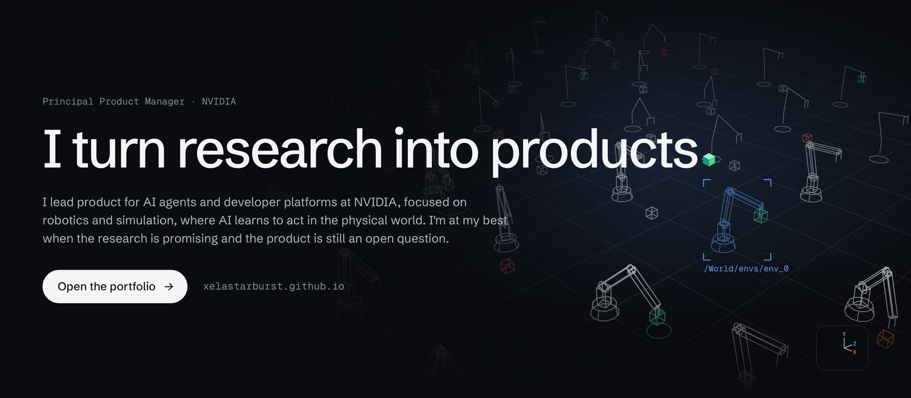
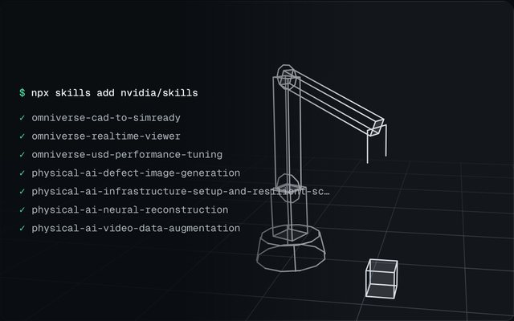
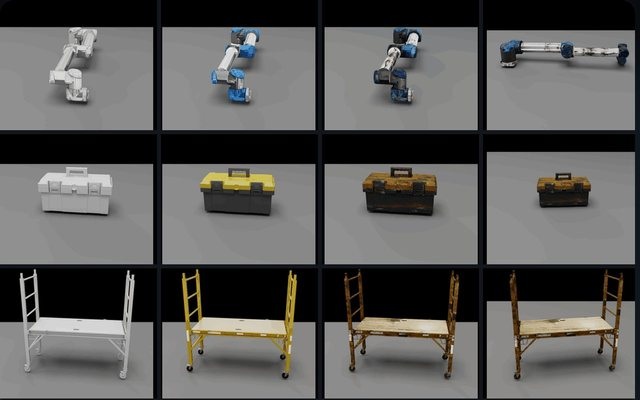
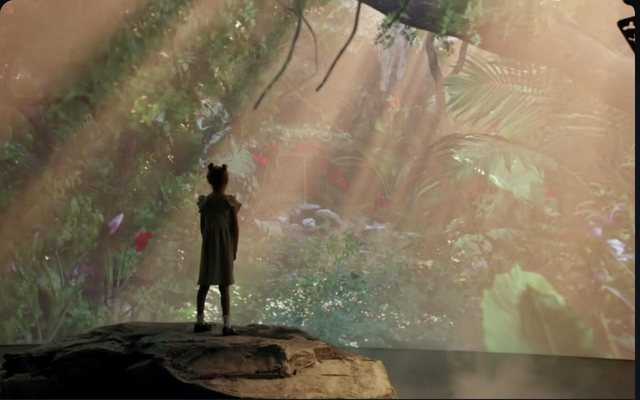
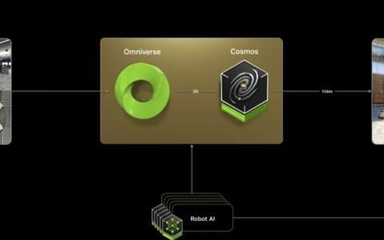
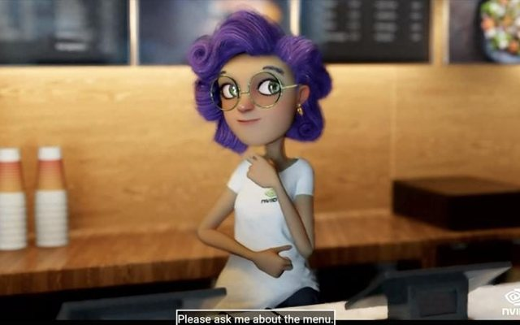
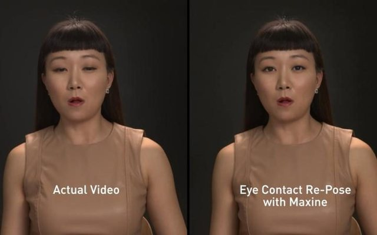
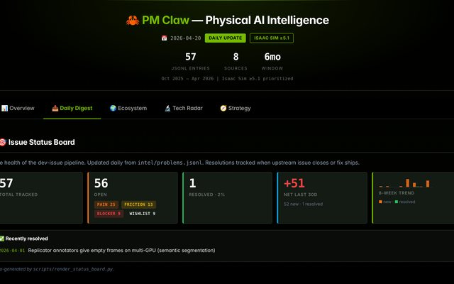
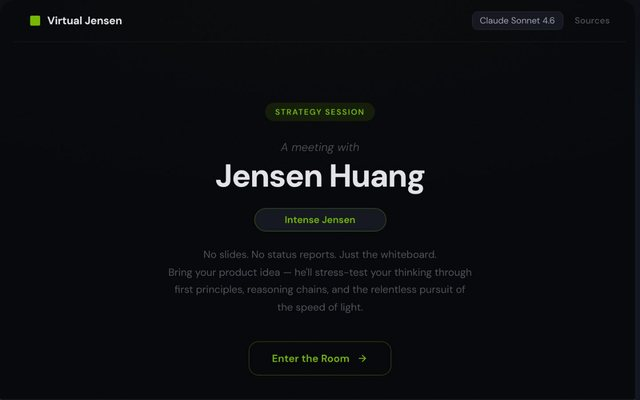

I lead product for AI agents and developer platforms at NVIDIA, focused on robotics and simulation, where AI learns to act in the physical world.

**[Open my portfolio →](https://xelastarburst.github.io)** · [LinkedIn](https://www.linkedin.com/in/alexlingqi/)

<table>
<tr>
<td width="25%" valign="top"> <a href="https://xelastarburst.github.io/#agents"><b>Agent-ready Physical AI</b></a> Skills, MCP servers and CI checks for coding agents</td>
<td width="25%" valign="top"> <a href="https://xelastarburst.github.io/#content-agents"><b>Content Agents</b></a> Open-source agents that prepare 3D assets for simulation</td>
<td width="25%" valign="top"> <a href="https://xelastarburst.github.io/#openusd"><b>Generative AI for OpenUSD</b></a> ChatUSD to USD Code and USD Search</td>
<td width="25%" valign="top"> <a href="https://xelastarburst.github.io/#cosmos"><b>Cosmos API launch</b></a> Two world foundation models on build.nvidia.com</td>
</tr>
<tr>
<td width="25%" valign="top"> <a href="https://xelastarburst.github.io/#speech-avatars"><b>Speech AI and avatars</b></a> Riva speech AI and Omniverse ACE</td>
<td width="25%" valign="top"> <a href="https://xelastarburst.github.io/#maxine"><b>Maxine</b></a> AI for video calls</td>
<td width="25%" valign="top"> <a href="https://xelastarburst.github.io/#pm-claw"><b>PM Claw</b></a> Side project: a daily intelligence pipeline</td>
<td width="25%" valign="top"> <a href="https://xelastarburst.github.io/#virtual-jensen"><b>Virtual Jensen</b></a> Side project: a strategy sparring partner. Unofficial</td>
</tr>
</table>

Side projects are personal work. The views in them are my own, not NVIDIA's.
